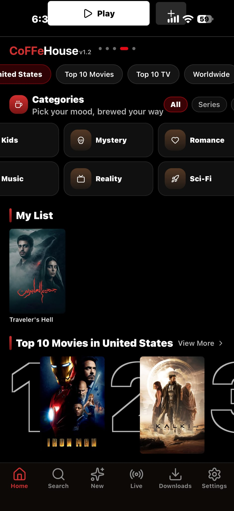
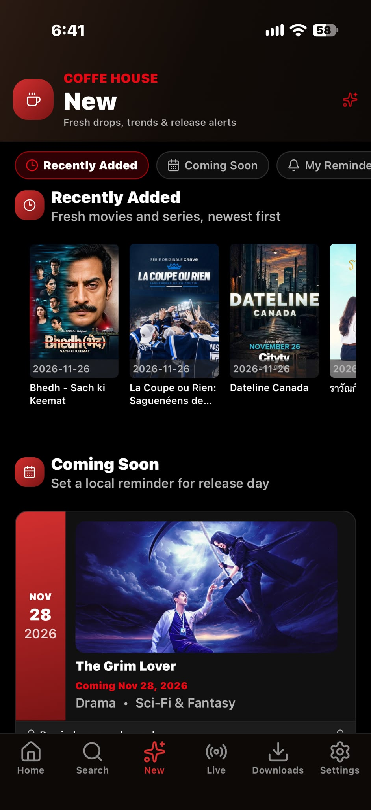
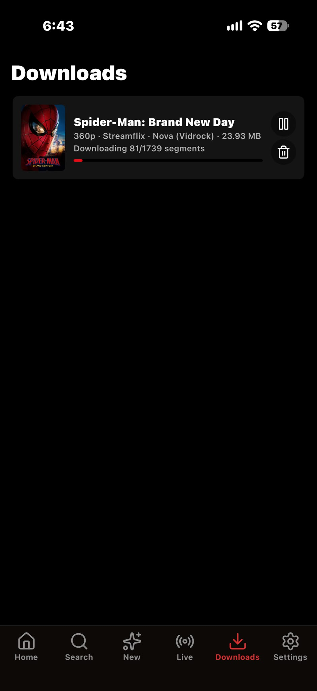

# ☕ كوفي هاوس 1.2

[](https://expo.dev)
[](https://reactnative.dev)
[]()
[]()

> تطبيق شخصي مبني بـ Expo و React Native لتصفح **الأفلام والمسلسلات**. البيانات والصور من TMDB، والتطبيق لا يوفّر ملفات أفلام أو مسلسلات ولا يستضيفها.

English: [README.md](./README.md)

---

## 📸 لقطات الشاشة

| الرئيسية | الجديد | التنزيلات |
|----------|--------|-----------|
|  |  |  |

---

## ✨ أبرز المزايا

- 🏠 **الرئيسية** — شريط أبطال، صفوف الأكثر مشاهدة، تصنيفات سريعة، شبكة تصنيفات مستوحاة من Nightflix، **قائمتي**، و**المتابعة من حيث توقفت** مع حفظ موضع التشغيل.
- 🆕 **الجديد** — **أُضيف حديثًا**، **قريبًا**، **تذكيراتي**، **الجميع يشاهد**، **أفضل 10 مسلسلات**، و**أفضل 10 أفلام**. الصفوف الثلاثة الأخيرة تستخدم ترند TMDB الأسبوعي.
- ⏰ **تذكير الإصدارات** — على الجوال يمكن جدولة إشعار محلي على الجهاز الساعة 09:00 بتوقيت الجهاز في تاريخ العرض حسب TMDB، وإدارته من **تذكيراتي**. على الويب وسطح المكتب تظهر فقط الرسالة: `Local release reminders are available in the mobile app.`
- ⬇️ **التنزيلات** — تنزيل مباشر أو HLS مع تقدّم حقيقي، إيقاف مؤقت/متابعة/إلغاء، تجميع حلقات المسلسل، وتشغيل الملفات المحلية. على سطح المكتب يمكنك اختيار مسار التخزين والتنزيل.
- 📺 **التلفاز الحي** — قنوات أفلام ومسلسلات عربية وإنجليزية فقط، مع جدول برامج EPG والمفضلة والأخيرة المشاهدة.
- 🔍 **التصفح** — بحث، صفحات الأشخاص (طاقم الممثلين)، إعدادات المنطقة، اختيار DNS، الترجمة، جودة الفيديو، نسبة العرض، الثيم الفاتح/الداكن/النظام، ودعم العربية RTL والإنجليزية.
- 📱 **مشغّل الجوال** — `react-native-video` (ExoPlayer/AVPlayer) مع ترجمة وسرعة وصورة داخل صورة ومتابعة التشغيل.
- 🖥️ **مشغّل سطح المكتب** — يبدأ بـ `hls.js`، ولا يستخدم FFmpeg المدمج إلا بعد أخطاء تشغيل حقيقية، وبحد أقصى محاولتين، ولا يُعاد تصعيد روابط `/__hls/` أو `/__relay/` أو `/__compat/` مرّة أخرى. لا يوجد libVLC.
- 🎬 كلمة **Cast** في الواجهة تعني **طاقم الممثلين** فقط، وليست إرسال الشاشة إلى التلفاز (لا Chromecast ولا DLNA ولا AirPlay).

> لا يوجد في كوفي هاوس وضع Watch Party، ولا زر «Check update»، ولا إضافات Xtream، ولا مشغّل libVLC.

قسم **أُضيف حديثًا** يبنى من أفلام TMDB `now_playing` مع مسلسلات كان تاريخ أول عرض لها خلال آخر 90 يومًا، مع استبعاد الأخبار وبرامج المقابلات والمسلسلات اليومية وبرامج الواقع كي يبقى القسم خاصًا بالأعمال الدرامية.

---

## ✅ الطلبات التي نُفّذت

> اضف reminder على تقويم خاص بلجهاز لعندما نزل فلم او مسلسل يرسلي تنبيه

> اضف recently added للفلام مسلسلات جديثه او قد موخرة تمت اضافتها

---

## 📦 المخرجات والبناء

| المنصة | المخرج | ملاحظات |
|--------|--------|---------|
| أندرويد | `.apk` | الحزمة `com.coffehouse.app`، الإصدار `1.2`، رقم البناء `20308` |
| iOS | `.ipa` غير موقّع | يُبنى عبر `.github/workflows/ios-ipa.yml` ويُنشر في الإصدار `ios-latest` |
| الويب | `dist-web/` | تصدير Expo web ثابت |
| ويندوز | `.msi` | **ويندوز 11 فقط**؛ التثبيت في مجلد `CoFFe House stream`؛ اسم المنتج والاختصارات `CoFFe House` |

```shell
npm install
npm start

# أندرويد APK release (بدون الحاجة إلى محاكٍ)
.\gradlew.bat assembleRelease --no-daemon

# تصدير الويب
npx expo export --platform web --output-dir dist-web --clear

# ملف MSI لويندوز من مجلد desktop/
$env:CSC_IDENTITY_AUTO_DISCOVERY='false'; npm run dist:msi
```

إعدادات workflow الخاصة بـ iOS تستخدم الإصدار `1.2` والبناء `20308` بشكل افتراضي. مخطط الروابط الداخلية على أندرويد هو `coffehouse`.

لتفاصيل غلاف Electron ومحرك FFmpeg وتخطيط التخزين راجع [desktop/README.md](./desktop/README.md).

---

## 🧹 تخزين سطح المكتب

التنزيلات وملفات التوافق منفصلتان. التنظيف يستهدف فقط `<storage>/compat/`، ويتخطى المهام النشطة، ويدعم `dryRun`، ولا يحذف `<storage>/downloads/` أبدًا.

---

## 🙏 الشكر والإسناد

- **The Movie Database (TMDB)** — بيانات الأفلام والمسلسلات والملصقات والخلفيات. يستخدم هذا المنتج واجهة TMDB لكنه ليس معتمدًا أو موثّقًا من TMDB. <https://www.themoviedb.org>
- **3vyz** — المطوّر والمشرف. <https://www.instagram.com/3vyz/>
- **Contact me** — الرقم `+97366607701` على واتساب. <https://wa.me/97366607701>

الإصدار الأصلي من تطوير **hanadi**، والصيانة الحالية من **3vyz**.

> شاهد ما تحب، بطريقتك.
