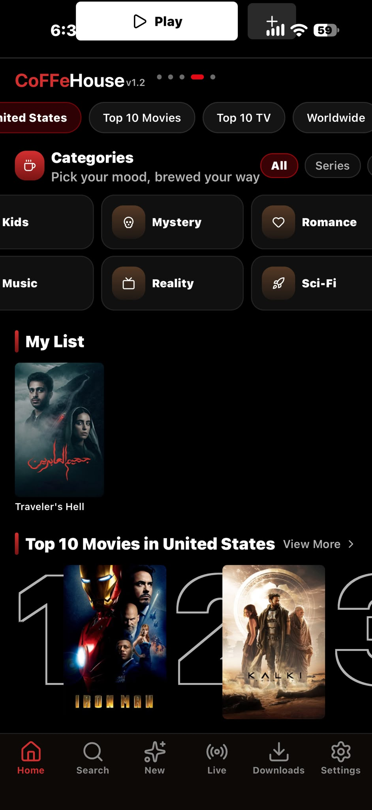
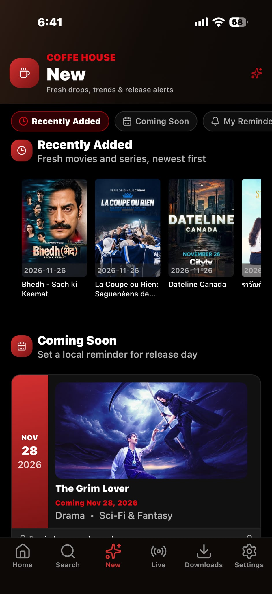
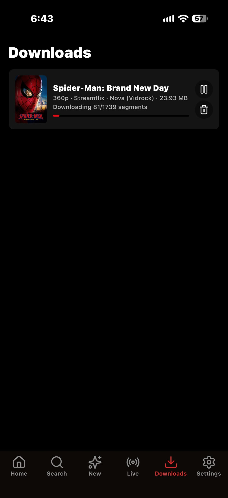

# ☕ CoFFe House 1.2

[](https://expo.dev)
[](https://reactnative.dev)
[]()
[]()
[]()

> A personal Expo / React Native media client for **movies and series**. Metadata and artwork come from TMDB; CoFFe House does not provide or host media files.

العربية: [README.ar.md](./README.ar.md)

---

## 📸 Screenshots

| Home | New | Downloads |
|------|-----|-----------|
|  |  |  |

---

## ✨ Highlights

- 🏠 **Home** — hero carousel, trending rows, genre chips, a Nightflix-inspired category grid, **My List**, and **Continue Watching** with resume position.
- 🆕 **New** — **Recently Added**, **Coming Soon**, **My Reminders**, **Everyone Watching**, **Top 10 Series**, and **Top 10 Films**. The three `Top`/`Everyone` rails use TMDB weekly trending.
- ⏰ **Release reminders** — on mobile, schedule a local notification for 09:00 on a TMDB release date and manage them from **My Reminders**. Web/desktop only shows: `Local release reminders are available in the mobile app.`
- ⬇️ **Downloads** — direct/HLS downloads with real progress, pause/resume/cancel, episode grouping, and local playback. Desktop lets you choose the storage/download path.
- 📺 **Live TV** — Arabic and English movie/series channels only, with EPG, favorites, and recently watched channels.
- 🔍 **Browse** — search, person pages (cast/crew), region settings, DNS picker, subtitles, video quality, aspect ratio, light/dark/system theme, and Arabic RTL + English.
- 📱 **Mobile player** — `react-native-video` (ExoPlayer/AVPlayer) with subtitles, speed, PiP, and resume.
- 🖥️ **Desktop player** — `hls.js` first; bundled FFmpeg is used only after real playback errors, at most twice, and `/__hls/`, `/__relay/`, and `/__compat/` URLs are never escalated again. No libVLC.
- 🎬 **Cast** in the UI means the **cast members / طاقم الممثلين** — not Chromecast, DLNA, AirPlay, or TV casting.

> CoFFe House does **not** include Watch Party, a “Check update” action, Xtream add-ons, or libVLC.

Recently Added is built from TMDB `now_playing` movies plus TV titles whose `first_air_date` falls in the last 90 days; news, talk, soap, and reality entries are excluded so the rail stays scripted.

---

## 📦 Builds

| Platform | Output | Notes |
|----------|--------|-------|
| Android | `.apk` | Package `com.coffehouse.app`, `versionName=1.2`, `versionCode=20308` |
| iOS | unsigned `.ipa` | Built by `.github/workflows/ios-ipa.yml`, published to release `ios-latest` |
| Web | `dist-web/` | Static Expo web export |
| Windows | `.msi` | **Windows 11 only**; installs to `CoFFe House stream`; product name and shortcuts are `CoFFe House` |

```shell
npm install
npm start

# Android release APK (no emulator required)
.\gradlew.bat assembleRelease --no-daemon

# Web export
npx expo export --platform web --output-dir dist-web --clear

# Windows MSI (from the desktop/ folder)
$env:CSC_IDENTITY_AUTO_DISCOVERY='false'; npm run dist:msi
```

The iOS workflow defaults to version `1.2` / build `20308`. The Android deep-link scheme is `coffehouse`.

See [desktop/README.md](./desktop/README.md) for the Electron shell, FFmpeg compatibility engine, and storage layout details.

---

## 🧹 Desktop storage

Downloads and compatibility files are kept separate. Cleanup targets only `<storage>/compat/`, skips active jobs, supports `dryRun`, and never deletes `<storage>/downloads/`.

---

## 🙏 Credits

- **The Movie Database (TMDB)** — movie/TV metadata, posters, and backdrops. This product uses the TMDB API but is not endorsed or certified by TMDB. <https://www.themoviedb.org>
- **3vyz** — maintainer and developer. <https://www.instagram.com/3vyz/>
- **Contact me** — `+97366607701` on WhatsApp. <https://wa.me/97366607701>

Originally developed by **hanadi**; maintained by **3vyz**.

> Watch what you love, your way.
